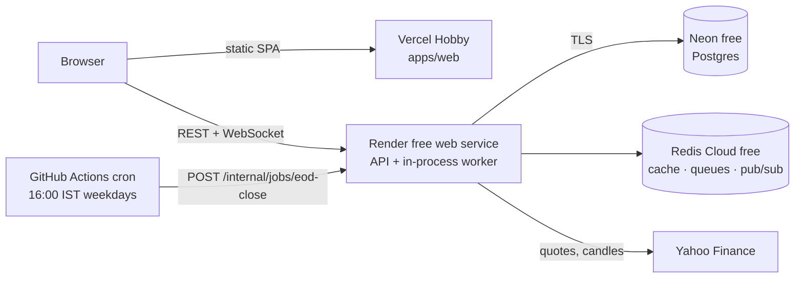

# Free deployment: Render + Neon + Redis Cloud + Vercel (US$0/month)

This runs the whole platform on free tiers, with no servers to manage and nothing to pay. It keeps the real
architecture (API, BullMQ worker, Postgres, Redis, WebSockets). The only changes are *where* each piece runs
and two settings that free tiers force on us.



| Piece | Service (free plan) | Why this one |
|---|---|---|
| Frontend | **Vercel** Hobby | Static Vite build plus SPA rewrites (`apps/web/vercel.json`) |
| API + worker | **Render** free web service (Docker) | Runs our Dockerfile unchanged; supports WebSockets. Defined in [`render.yaml`](../render.yaml) |
| Postgres | **Neon** Free | 1 GB storage and 100 CU-hours/month per project; scales to zero after 5 minutes idle |
| Redis | **Redis Cloud** Free (30 MB) | No monthly command quota, which BullMQ needs ([see below](#why-not-upstash)) |
| Daily job trigger | **GitHub Actions** scheduled workflow | Wakes the sleeping API at 16:00 IST: [`scheduled-jobs.yml`](../.github/workflows/scheduled-jobs.yml) |

## What free tiers change, and how the code handles it

| Free-tier constraint | Consequence | What the app does |
|---|---|---|
| Render has **no free background workers** | No separate `apps/worker` service | `RUN_WORKER=true` runs the same BullMQ consumers and schedulers **inside the API process** (`apps/api/src/inProcessWorker.ts`). Moving back to a dedicated worker is a config change. |
| Render has **no free pre-deploy step** | Migrations can't run as a release step | `MIGRATE_ON_START=true` migrates before listening. The runner is advisory-locked, so concurrent boots are safe. |
| Render **sleeps after 15 min idle**, cold start ~1 min | Redis-stored BullMQ schedules can't fire while asleep | A GitHub Actions cron calls `POST /internal/jobs/eod-close` with `Authorization: Bearer $CRON_SECRET`. That wakes the service and enqueues the job. The job is idempotent, so a double run is harmless. |
| Fresh databases start empty | Needs instruments, candles and a demo account | `SEED_ON_START=true` runs the idempotent bootstrap in the background: NIFTY 50 sync, **only missing candles** (about the last 7 days on restarts), demo account with fixed Idempotency-Keys. |
| Redis Cloud free has a low **ops/sec** cap | A quote refresh must be cheap | A refresh costs N + 1 commands (one `HSET` for last-known prices), and `QUOTE_POLL_INTERVAL_MS=15000`. A test counts the commands on the server. |
| Data provider politeness | Polling a closed market is waste | Outside 09:15–15:30 IST on weekdays, quotes refresh at most every 10 minutes. |
| Neon **scales to zero** | First query after idle takes ~1 s | Nothing to do: the pg pool reconnects; idle-client errors are logged, not fatal. |

### Why not Upstash?

Upstash's free plan caps usage at **500K commands a month**. BullMQ keeps workers connected and checks for
stalled jobs even when idle, and users have reported idle queues reaching millions of commands a month on
metered Redis. Redis Cloud's free plan is small (30 MB) but has no command quota. That fits this app:
BullMQ trims completed jobs, and the quote cache is about 50 keys plus one hash.

---

## Step-by-step (about 20 minutes, done once)

### 1. Neon (Postgres)

1. Sign up at **neon.com** (GitHub login works) → *Create project* `nse-paper-trading` → region
   **AWS Asia Pacific (Singapore)**.
2. *Connect* → turn **Connection pooling off**, so you get the *direct* host without `-pooler`. The migration
   runner uses a session advisory lock, which a transaction pooler can't hold.
3. Copy the connection string and change `sslmode=require` to **`sslmode=verify-full`**. node-postgres
   already treats `require` as `verify-full` and warns about it; Neon's certificates are publicly trusted.
   ```
   postgresql://neondb_owner:<password>@ep-xxxx.ap-southeast-1.aws.neon.tech/neondb?sslmode=verify-full
   ```

### 2. Redis Cloud (Redis)

1. Sign up at **redis.io/try-free** → create the **Free** (30 MB) database → cloud **AWS**, region
   **ap-south-1 (Mumbai)** or **ap-southeast-1 (Singapore)**.
2. Database → *Configuration*: set **Data eviction policy = `noeviction`**. BullMQ requires it: evicting
   queue keys would lose jobs.
3. Copy the public endpoint and the `default` user's password:
   ```
   redis://default:<password>@redis-12345.c1.ap-south-1-1.ec2.redns.redis-cloud.com:12345
   ```

### 3. Render (API + worker)

1. Sign up at **render.com** with GitHub → *New* → **Blueprint** → choose this repository. Render reads
   [`render.yaml`](../render.yaml).
2. Fill in the three prompted values:
   - `DATABASE_URL`: from step 1
   - `REDIS_URL`: from step 2
   - `CORS_ORIGINS`: put `https://placeholder.vercel.app` for now; you'll set the real one in step 4
3. *Apply*. The first build takes a few minutes. When it's done:
   - `https://<service>.onrender.com/ready` → `{"status":"ready","db":"up","redis":"up"}`
   - `https://<service>.onrender.com/docs` → Swagger
   - Logs show `migrations checked`, `in-process worker started`, then `bootstrap complete` (Yahoo candles
     ingested, demo account ready).
4. In the service's *Environment* tab, copy the generated **`CRON_SECRET`** for step 5.

### 4. Vercel (frontend)

1. Sign up at **vercel.com** with GitHub → *Add New → Project* → import this repository.
2. **Root Directory: `apps/web`**. `apps/web/vercel.json` already sets the install command (`npm ci` at the
   monorepo root), the build command and the SPA rewrites.
3. Environment variable **`VITE_API_URL` = `https://<service>.onrender.com`**, then *Deploy*.
4. Back in Render, set **`CORS_ORIGINS`** to your Vercel production URL (e.g.
   `https://nse-paper-trading.vercel.app`). Render redeploys automatically.

### 5. GitHub Actions (daily job trigger)

Repository → *Settings → Secrets and variables → Actions*:

- **Variables** → `API_BASE_URL` = `https://<service>.onrender.com`
- **Secrets** → `CRON_SECRET` = the value from step 3.4

Test it: *Actions → Scheduled jobs → Run workflow* (job `eod-close`). The Render logs should show
`eod complete`. Until these two are set, the workflow skips with a notice instead of failing.

### 6. Check it

Open the Vercel URL → *Try the demo account* (`demo@nsepaper.dev` / `Demo@12345`) → the header shows **Live** →
buy something → a "filled" toast arrives over the WebSocket.

---

## What to expect from free tiers

| Behaviour | Detail |
|---|---|
| **Cold start** | After 15 min without traffic Render sleeps the service; the next visit waits about a minute. Open the site a minute before a demo. |
| **Worker runs only while awake** | Queued orders, quote polling and the reconciler run while the service is up. The daily job is covered by the GitHub cron, and missed days are caught up by the EOD look-back window. |
| **Live prices** | Flow while the service is awake and the market is open; outside market hours quotes refresh every 10 min. |
| **Yahoo Finance** | Unofficial and rate-limited. If it fails, fills reject with `PRICE_UNAVAILABLE`, and the UI shows last known prices. |
| **Limits** | Neon 1 GB (the 2-year candle history is a few MB); Redis Cloud 30 MB; Render 512 MB RAM / 0.1 CPU. Fine for a demo; the load-test numbers in [LOAD_TESTING.md](LOAD_TESTING.md) come from the Docker Compose stack, not this. |
| **Cost** | US$0. Provider plans change, so check each pricing page before relying on it. |

## How this was verified before deploying

The accounts themselves were not created from the build sandbox. The configuration and the exact runtime mode
were checked locally:

- `render.yaml` validates against **Render's published Blueprint JSON schema**; both workflows validate against
  GitHub's workflow schema.
- The **production Docker image** was run the way Render runs it: `PORT=10000`, `RUN_WORKER`,
  `MIGRATE_ON_START`, `SEED_ON_START`, against an **empty** database. It came up healthy (Docker
  `HEALTHCHECK`), as the non-root user, migrated, seeded, and filled queued orders in-process.
- A restart was shown to be **incremental and idempotent**: no migrations re-run, about 7 days of candles
  refreshed, still exactly 6 demo orders.
- The cron endpoint returns 404 without a configured secret and 401 with a wrong one; with the right one it
  enqueues the job, which the in-process worker ran (`eod complete`).
- The frontend was **built as Vercel builds it** (`VITE_API_URL` pointing at another origin) and driven in
  Chromium from a different origin: REST and `ws://…/ws` both went cross-origin, the CORS preflight allowed
  `Idempotency-Key`, live ticks arrived, a market order was filled via the queue and confirmed over the socket.
- Hosted-Redis URLs (`rediss://`, user, password, port) are parsed correctly by both ioredis and BullMQ.
